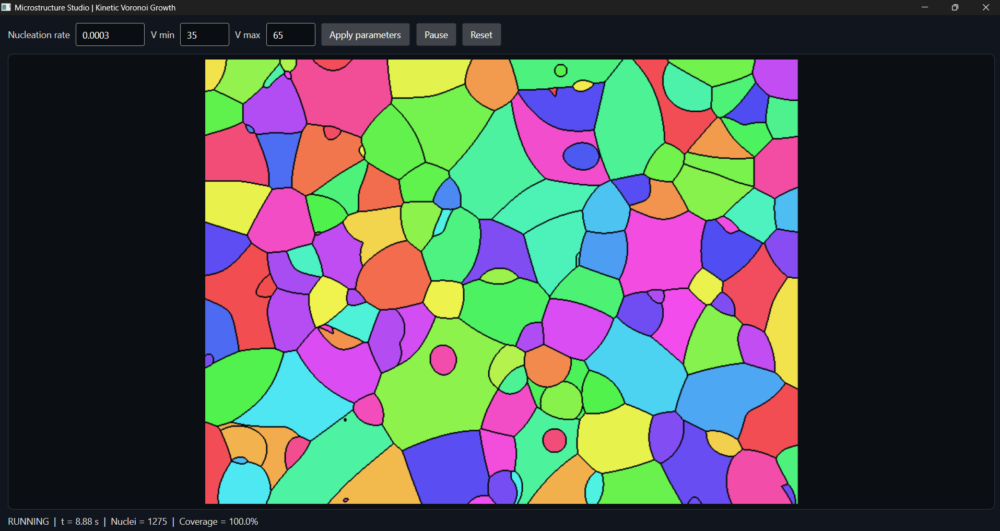

# Microstructure Studio

**A real-time 2D nucleation and grain-growth demonstrator built with Avalonia UI and a native C++ engine.**

Microstructure Studio couples a cross-platform-style .NET desktop UI with a standalone C++17 simulation library. The current application targets Windows x64 and demonstrates continuous nucleation, isotropic grain growth, impingement and live visualization.

> **Project status:** early-stage research / educational prototype. The model and numerical implementation are intentionally compact. See [model limitations](docs/mathematical-model.md).

## Features

- Continuous stochastic nucleation using a Poisson process.
- Isotropic circular growth with a configurable random velocity interval.
- Kinetic Voronoi-like grain ownership based on earliest arrival time.
- Per-grain colour assignment and pixel-level boundary rendering.
- Live simulation controls, time, grain count and area coverage.
- Native C++ engine exposed through a small C ABI and consumed through C# P/Invoke.
- CMake build support for MSVC and MinGW-w64.
- Self-contained .NET publishing for Windows x64.
- Static compiler runtime linking options for native Windows deployment.

**OpenMP is not implemented in this version.** The simulation and renderer currently run serially in the native engine.

## Screenshot




## Architecture

```text
Avalonia UI / C# / .NET 10
        |
        | P/Invoke (C ABI)
        v
MicrostructureCore.dll / C++17
        |
        +-- Poisson nucleation
        +-- isotropic radial growth
        +-- earliest-arrival pixel ownership
        +-- RGBA framebuffer rendering
        |
        v
Avalonia WriteableBitmap
```

- `managed/` — Avalonia desktop application and P/Invoke declarations.
- `native/` — independent C++ simulation engine.
- `docs/` — architecture and mathematical model.
- `scripts/` — build and run helpers for both compiler toolchains.

The native library does not depend on Avalonia or .NET. This separation is intentional so the engine can later be reused by other front ends.

## Mathematical model

For a domain of area \(A\), nucleation rate \(I\), and time increment \(\Delta t\), the number of new nuclei is sampled as:

\[
N_{\mathrm{new}} \sim \operatorname{Poisson}(I A \Delta t)
\]

A nucleus \(i\), born at \((x_i,y_i)\) at time \(t_i\), grows at constant radial velocity \(v_i\):

\[
R_i(t)=v_i(t-t_i)
\]

The arrival time at a point is:

\[
\tau_i(x,y)=t_i+
\frac{\sqrt{(x-x_i)^2+(y-y_i)^2}}{v_i}
\]

The grain with the earliest arrival time owns that point:

\[
G(x,y)=\underset{i}{\operatorname{argmin}}\;\tau_i(x,y)
\]

The engine samples the continuous model at pixel centres and updates the newly swept annulus of each grain. See [docs/mathematical-model.md](docs/mathematical-model.md) for assumptions and limitations.

## Requirements

- Windows 10/11 x64
- CMake 3.21 or newer
- Ninja
- One C++17 compiler:
  - MSVC x64 (Visual Studio Build Tools / WinDev MSVC environment), or
  - MinGW-w64 GCC
- .NET 10 SDK
- Internet access for the first NuGet restore, unless dependencies are already available in the configured NuGet cache

The managed project currently references Avalonia 11.3.10.

## Build

Open the appropriate WinDev terminal with the compiler, CMake, Ninja and `dotnet` available on `PATH`. Run commands from the repository root.

### MSVC

```bat
scripts\build-msvc.bat
```

This configures `build_msvc/`, builds `MicrostructureCore.dll` with the static MSVC runtime (`/MT` for Release), publishes the managed application as self-contained `win-x64`, and copies the native DLL beside the executable.

Run:

```bat
scripts\run-msvc.bat
```

### MinGW-w64

```bat
scripts\build-mingw.bat
```

This configures `build_mingw/`, builds the native DLL with static GCC / C++ runtime link options, publishes the managed application as self-contained `win-x64`, and copies the native DLL beside the executable.

Run:

```bat
scripts\run-mingw.bat
```

### Direct CMake commands

MSVC:

```bat
cmake -S . -B build_msvc -G Ninja -DCMAKE_BUILD_TYPE=Release
cmake --build build_msvc --target publish_dotnet
```

MinGW:

```bat
cmake -S . -B build_mingw -G Ninja -DCMAKE_BUILD_TYPE=Release
cmake --build build_mingw --target publish_dotnet
```

The publish directory is:

```text
build_<toolchain>/dotnet_publish/
```

It contains `MicrostructureStudio.exe`, managed dependencies, the self-contained .NET runtime, and `MicrostructureCore.dll`.

To create a smaller framework-dependent build instead, configure with:

```bat
-DMS_DOTNET_SELF_CONTAINED=OFF
```

That deployment requires the matching .NET 10 Desktop Runtime on the target computer.

## Simulation defaults

| Parameter | Default |
|---|---:|
| Domain | 800 × 600 pixels |
| Nucleation rate | 0.000012 nuclei / pixel / second |
| Minimum growth velocity | 35 pixels / second |
| Maximum growth velocity | 65 pixels / second |
| UI timer interval | approximately 33 ms |

These are demonstration values, not calibrated material parameters.

## Deployment notes

- The application is published for `win-x64`.
- Self-contained publishing bundles the .NET runtime; it does not bundle Windows itself.
- The MSVC native DLL uses the static MSVC runtime in Release configuration.
- MinGW builds request static GCC and C++ runtimes. Verify actual dependencies for the chosen MinGW distribution with `objdump -p MicrostructureCore.dll`.
- Windows system DLLs and API-set dependencies remain operating-system dependencies.
- Before redistributing binaries, review [THIRD-PARTY-NOTICES.md](THIRD-PARTY-NOTICES.md) and include the full applicable third-party licence texts and runtime notices.

## Repository hygiene

Build directories, `bin/`, `obj/`, PDB files, publish output and archives are excluded by `.gitignore`. Do not commit local WinDev paths, compiler installations, NuGet caches or generated binaries.

## Roadmap

- [ ] OpenMP acceleration and reproducible performance benchmarks.
- [ ] Shape-harmonic / anisotropic growth models.
- [ ] Grain statistics and data export.
- [ ] Spatial acceleration for larger domains.
- [ ] Move simulation work off the UI thread.
- [ ] Optional VTK-based visualization and 3D extensions.

## License

The original Microstructure Studio source code is distributed under the MIT License. See [LICENSE](LICENSE).

Third-party dependencies remain under their respective licences. See [THIRD-PARTY-NOTICES.md](THIRD-PARTY-NOTICES.md).
